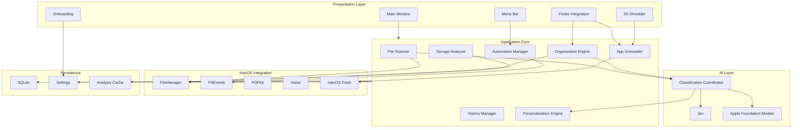
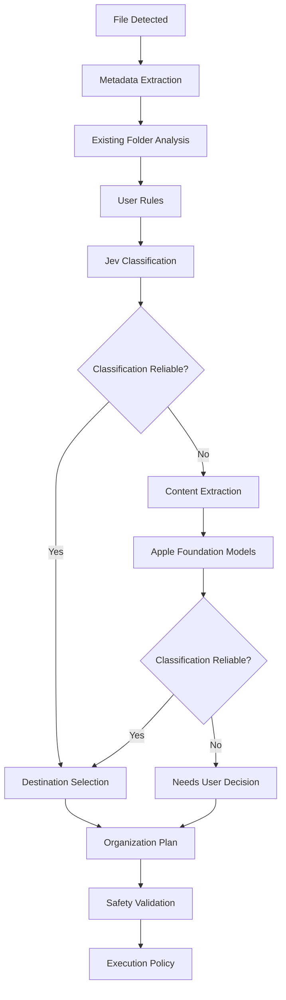
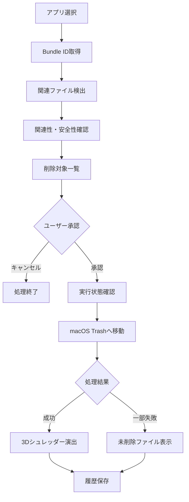
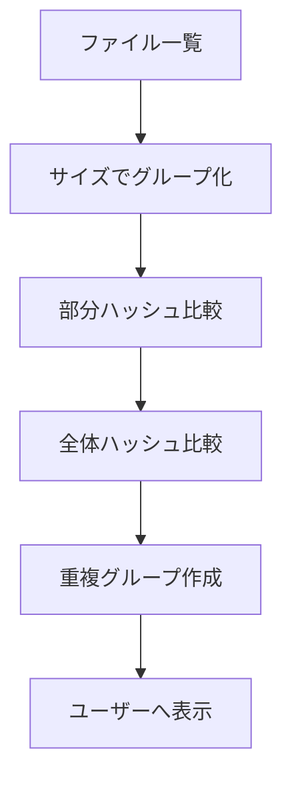
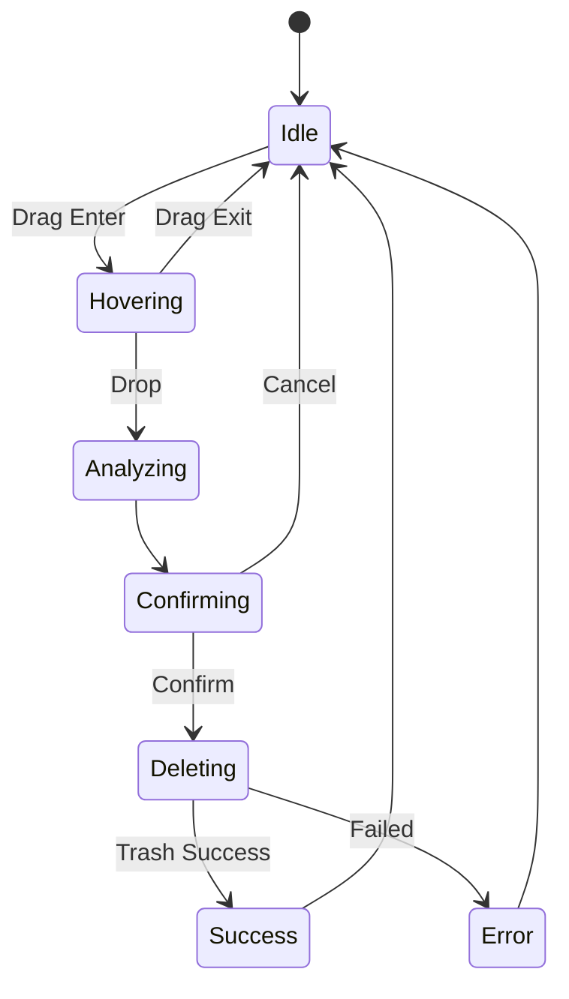

# Shredder
## macOS AI File Organizer & Uninstaller
### 完全実装仕様書 v1.0

> 散らかったMacを、もっとスマートに。

---

# 1. プロジェクト概要

## 1.1 基本情報

| 項目 | 内容 |
|---|---|
| プロダクト名 | Shredder |
| プラットフォーム | macOS |
| 対応OS | macOS 26以降を想定（要確認） |
| 対応CPU | Apple Silicon |
| 開発言語 | Swift |
| UI | SwiftUI / AppKit |
| デザイン | Apple純正アプリ風 / Liquid Glass |
| 3D | RealityKitを第一候補 |
| AI | Jev + Apple Foundation Models |
| データベース | SQLite |
| ファイル操作 | Foundation / FileManager |
| アプリ形態 | 通常ウィンドウ + メニューバー常駐 |
| ネットワーク | AI解析は原則オフライン |
| 削除方式 | macOSのゴミ箱への移動のみ |

## 1.2 プロダクトコンセプト

Shredderは、Mac内のファイルをAIが理解し、自動的に整理するとともに、不要なファイルやアプリケーションを直感的に削除できるmacOSネイティブアプリケーションである。

ファイル整理、アプリ完全アンインストール、ストレージ分析、自動化、パーソナライズを単一のアプリケーションに統合する。

インターフェースはApple純正アプリのようにシンプルで洗練されたものとし、削除操作の中心にはインタラクティブな3Dシュレッダーを配置する。

## 1.3 開発方針

本仕様書に記載されている機能は、すべて正式リリースに必要な実装対象とする。

機能をMVP・追加機能・将来機能に分類しない。

以下をすべて実装する。

- AIファイル整理
- Jevによる一次分類
- Apple Intelligenceによる二次解析
- 既存フォルダを考慮した整理
- ユーザーの整理習慣の学習
- 手動・半自動・完全自動整理
- 指定フォルダ整理
- Mac全体分析
- フォルダ監視
- リアルタイム整理
- スケジュール整理
- ワンクリック整理
- アプリ完全アンインストール
- アプリ関連ファイル検出
- 削除済みアプリの残骸検出
- ストレージ分析
- 大容量ファイル検出
- 重複ファイル検出
- フォルダ容量の可視化
- 3Dシュレッダー
- 削除アニメーション
- サウンドフィードバック
- Finderドラッグ＆ドロップ
- Finderクイックアクション
- メニューバー常駐
- ログイン時起動
- 操作履歴
- Undo
- 初回起動アニメーション
- オンボーディング
- バックグラウンド処理
- 省電力制御

すべての機能を統合した状態を完成条件とする。

---

# 2. システム全体構成

## 2.1 アーキテクチャ



## 2.2 設計原則

- UIとビジネスロジックを分離する
- AI判断とファイル操作を分離する
- ファイル操作を共通エンジンに集約する
- AIが直接ファイルを削除しない
- ファイル操作前にアクセス権限を検証する
- すべての変更操作を履歴に記録する
- 非同期処理によりUIをブロックしない
- AIエンジンを交換可能な構造とする
- システムAPIへのアクセスを抽象化する

---

# 3. AIエンジン

## 3.1 AI構成

Shredderは2段階のAI判断を採用する。

### 一次判断

Jevを使用する。

### 二次判断

Apple Foundation Modelsを使用する。

### 補助処理

ルールエンジンとmacOS標準APIを使用する。

## 3.2 AI処理フロー



## 3.3 Jev

Jevは高速なファイル分類を担当する。

入力として、以下を利用する。

- ファイル名
- 拡張子
- ファイルサイズ
- 保存場所
- 既存フォルダ
- ファイルの種類
- 過去の分類履歴
- ユーザーの整理ルール

出力はShredder内部の共通形式に変換する。

### 内部データモデル

```swift
struct ClassificationResult: Codable {
    let category: String
    let subcategory: String?
    let suggestedDestination: URL?
    let confidence: Double?
    let reason: String
    let requiresDeepAnalysis: Bool
}
```

Jevの実際のAPI仕様、レスポンス形式、信頼度の有無、ローカル実行方法は要確認。

実在しないAPIやSDKを仮定して実装しないこと。

## 3.4 Apple Foundation Models

Jevで判断できない場合のみ使用する。

### 使用目的

- 文章の意味理解
- 資料の用途判定
- プロジェクトとの関連性判定
- ファイルカテゴリの推測
- 既存フォルダとの意味的な比較

### 入力処理

ファイル形式に応じて情報を抽出する。

| ファイル形式 | 解析方法 |
|---|---|
| PDF | PDFKit |
| テキスト | Foundation |
| 画像 | Visionなど |
| Office文書 | 対応する解析手段を使用（要確認） |
| その他 | メタデータ中心に分類 |

Foundation Modelsに渡す内容は必要最小限とする。

モデルが利用できない場合は、Jevとルールエンジンで処理を継続する。

## 3.5 信頼度判定

AIが返す信頼度をそのまま正解確率とは扱わない。

以下を組み合わせて判断する。

- 分類結果の一貫性
- 過去の整理履歴との一致
- フォルダ名との意味的一致
- ユーザールールとの一致
- 候補間の差
- 操作の危険度

判断不能な場合はファイルを移動しない。

---

# 4. ファイルスキャン

## 4.1 スキャン対象

以下に対応する。

1. 指定フォルダ
2. Mac全体のアクセス可能な領域
3. 監視対象フォルダ

## 4.2 取得する情報

```swift
struct FileRecord: Identifiable {
    let id: UUID
    let url: URL
    let name: String
    let fileExtension: String
    let size: Int64
    let createdAt: Date?
    let modifiedAt: Date?
    let contentType: String?
    let contentHash: String?
}
```

追加で必要な場合は以下を取得する。

- Finderタグ
- ファイルの種類
- 親フォルダ
- ファイルの識別情報
- アクセス権限
- シンボリックリンク情報
- リソース値

## 4.3 スキャン方式

- 非同期処理
- キャンセル対応
- 進捗表示
- 差分スキャン
- 解析キャッシュ
- 大量ファイルの分割処理
- フォルダ階層の再帰的探索
- 保護領域の除外
- シンボリックリンク循環の防止

## 4.4 スキャン結果

スキャン完了後に以下を生成する。

- ファイル一覧
- カテゴリ別集計
- 整理候補
- 削除候補
- 重複候補
- 容量分析
- アクセス不能ファイル一覧

---

# 5. AIファイル整理

## 5.1 基本方針

**既存フォルダの活用を優先し、必要な場合だけ新規フォルダを作成する。**

## 5.2 整理先決定の優先順位

1. ユーザーの明示的な整理ルール
2. 過去のユーザー修正
3. 関連する既存フォルダ
4. AIによる新規フォルダ提案
5. 判断保留

## 5.3 整理アクション

```swift
enum OrganizationAction {
    case move
    case createFolder
    case keep
    case requestReview
}
```

削除は整理アクションから独立して管理する。

AI整理によって勝手に削除操作が発生しない構成とする。

## 5.4 整理プレビュー

実行前に以下を表示する。

- ファイル名
- 現在の場所
- 推奨移動先
- 判断理由
- 分類の信頼性
- 操作結果の予測
- 同名ファイルの衝突

---

# 6. AI整理モード

## 6.1 手動モード

すべての整理操作についてユーザーの承認を必要とする。

- 個別承認
- 一括承認
- 整理先変更
- 保留
- 除外

## 6.2 半自動モード

安全で信頼性の高い整理を自動実行する。

判断が曖昧なファイルは確認待ちにする。

自動実行の判断にはAIの信頼度だけでなく、操作の危険度も利用する。

## 6.3 完全自動モード

許可されたフォルダで、分類・ファイル移動・フォルダ作成を自動実行する。

ただし、以下は禁止する。

- ユーザー確認なしの削除
- システムファイル変更
- 許可範囲外へのアクセス
- 不確実なファイルの強制移動
- 意図しない上書き

## 6.4 モード切り替え

ホーム画面とファイル整理画面から変更できる。

現在のモードは明確に表示する。

---

# 7. 自動整理

## 7.1 実行方式

以下をすべて実装する。

### リアルタイム整理

ファイルの追加・更新を検知して整理する。

### スケジュール整理

指定した日時・曜日に整理する。

### ワンクリック整理

ユーザー操作によって即時に整理を開始する。

## 7.2 初期設定

| 実行方式 | 初期状態 |
|---|---|
| リアルタイム | OFF |
| スケジュール | OFF |
| ワンクリック | ON |

## 7.3 フォルダ監視

FSEventsなどを使用する。

監視イベント：

- ファイル追加
- ファイル変更
- ファイル移動
- ファイル削除

## 7.4 書き込み完了判定

ダウンロード中や書き込み中のファイルを誤って移動しない。

以下の情報を組み合わせて判定する。

- 更新日時
- ファイルサイズ
- 一時ファイル拡張子
- ファイル変更イベント
- 一定時間の安定状態

判断できない場合は処理を保留する。

## 7.5 処理キュー

```swift
enum TaskStatus {
    case pending
    case processing
    case deferred
    case completed
    case failed
    case cancelled
}
```

処理キューはアプリ終了後も必要な状態を復元できるよう永続化する。

---

# 8. パーソナライズ

## 8.1 学習機能

以下の3種類を実装する。

1. 整理履歴の学習
2. ユーザーの修正から学習
3. フォルダ別整理ルール

## 8.2 学習データ

- ファイルカテゴリ
- 元の保存先
- 移動先
- ユーザーによる修正
- 承認・却下履歴
- フォルダ別ルール

すべてローカルに保存する。

## 8.3 学習方式

AIモデル自体を再学習しない。

履歴やルールを検索し、分類時のコンテキストとして利用する。

## 8.4 優先順位

```text
Explicit User Rules
        ↓
User Corrections
        ↓
Historical Patterns
        ↓
Jev Classification
        ↓
Apple Foundation Models
```

ユーザーの明示的なルールを優先する。

---

# 9. アプリ完全アンインストール

## 9.1 基本仕様

アプリ本体と専用の関連ファイルをまとめて削除する。

アンインストールモードは完全削除のみとする。

削除先は常にmacOSのゴミ箱とする。

## 9.2 検出対象

| 種類 | 対応 |
|---|---|
| .app本体 | 削除 |
| Caches | 削除 |
| Preferences | 削除 |
| Application Support | 削除 |
| Logs | 削除 |
| Saved Application State | 削除 |
| 専用Containers | 削除 |
| Group Containers | 共有状況を確認 |
| Launch Agents | 所有関係を確認 |
| Launch Daemons | 権限と所有関係を確認 |
| ユーザー作成データ | 原則除外 |
| 他アプリの共有データ | 原則除外 |

## 9.3 関連ファイル判定

以下を利用する。

- Bundle Identifier
- アプリ名
- 開発元
- 関連ファイル名
- ディレクトリ名
- 既知の関連パス
- アプリのメタデータ
- Jevによる補助分類

AIの推測だけで関連ファイルを削除対象に確定しない。

## 9.4 削除フロー



## 9.5 アプリ削除画面

表示情報：

- アプリアイコン
- アプリ名
- Bundle ID
- 本体容量
- 関連データ容量
- 最終使用日時（取得可能な場合）
- 削除対象一覧
- 削除ボタン

## 9.6 実行中アプリ

アプリが実行中の場合は終了を促す。

強制終了は標準動作にしない。

## 9.7 権限制限

macOSの保護によりアクセスできない領域がある場合、削除できなかったファイルを表示する。

管理者権限が必要な操作を無断実行しない。

---

# 10. ファイル削除方式

## 10.1 基本仕様

削除方式はmacOSのゴミ箱への移動のみとする。

即時削除モードは実装しない。

## 10.2 削除対象

- 通常ファイル
- フォルダ
- アプリケーション
- アプリ専用関連ファイル
- 重複ファイル
- アプリ残骸

## 10.3 削除時の確認

必ず削除対象を表示して承認を求める。

表示項目：

- 対象名
- ファイル数
- 合計サイズ
- 削除対象の場所
- 関連ファイル
- 共有データに関する注意

## 10.4 ゴミ箱

- macOSのゴミ箱へ移動する
- 自動的にゴミ箱を空にしない
- ゴミ箱が空になる前は復元支援を行う
- 完全な復元を保証しない

---

# 11. 削除済みアプリの残骸検出

過去にアンインストールされたアプリの残存データを検出する。

対象：

- キャッシュ
- 設定ファイル
- Application Support
- ログ
- 専用Containers

インストール済みアプリとの関連性を調査する。

アプリ本体が存在しないだけでは不要と確定しない。

削除は必ずユーザーの承認後に行う。

---

# 12. ストレージ分析

## 12.1 機能

以下をすべて実装する。

1. ストレージ容量の可視化
2. 大容量ファイル検出
3. 重複ファイル検出
4. アプリ残骸検出
5. フォルダ容量分析

## 12.2 ストレージ可視化

表示項目：

- 使用容量
- 空き容量
- ファイル種類別容量
- フォルダ別容量
- 大容量ファイル
- 重複候補

OSのストレージ使用量表示と、Shredderがアクセスできるファイルの集計値は異なる場合があるため、両者を区別する。

## 12.3 重複ファイル検出



ファイル名だけで重複判定しない。

APFSクローンやハードリンクによる容量共有を考慮する。

## 12.4 ツリーマップ

フォルダ容量を長方形の面積で可視化する。

操作：

- フォルダをクリック
- 下位フォルダへ移動
- サイズ順表示
- ファイル詳細を表示
- 削除候補としてシュレッダーへ送る

---

# 13. 画面構成

## 13.1 全体

6つのメイン画面を設ける。

| 画面 | 機能 |
|---|---|
| ホーム | 整理状況・スキャン開始 |
| ファイル整理 | AI分類・整理操作 |
| ストレージ分析 | 容量・重複検出 |
| アプリ削除 | 完全アンインストール |
| 履歴 | 操作履歴・Undo |
| 設定 | 各種設定 |

## 13.2 ナビゲーション

macOS標準のサイドバー形式とする。

```text
Shredder
│
├── Home
├── File Organizer
├── Storage
├── Applications
├── History
└── Settings
```

## 13.3 ホーム

表示要素：

- ストレージ状況
- 整理候補数
- 削除候補容量
- 最終スキャン日時
- 最近の操作
- スキャン開始ボタン
- 整理モード切り替え
- 3Dシュレッダー

## 13.4 ファイル整理

3カラムレイアウト。

### 左

- フォルダ一覧
- 整理対象
- フィルター

### 中央

- ファイル一覧
- カテゴリ
- AI整理先
- 推奨アクション

### 右

- ファイル詳細
- AI判断理由
- 整理先変更
- 承認・保留・除外

## 13.5 ストレージ分析

- 容量グラフ
- ツリーマップ
- 大容量ファイル
- 重複ファイル
- アプリ残骸

## 13.6 アプリ削除

- アプリ一覧
- 関連ファイル
- 合計容量
- 完全削除

## 13.7 履歴

- 日時
- ファイル
- 操作
- 元の場所
- 移動先
- 実行結果
- Undo

## 13.8 設定

カテゴリ：

- AI
- 整理
- 監視
- 学習
- 安全性
- 外観
- サウンド
- バックグラウンド

---

# 14. 3Dシュレッダー

## 14.1 デザイン

Apple製品をイメージしたミニマルな工業デザイン。

| 項目 | 仕様 |
|---|---|
| 本体素材 | マットアルミニウム |
| カラー | シルバー / スペースブラック |
| 形状 | 角を丸めた直方体 |
| 投入口 | 上部の細長いスリット |
| LED | 小型ステータスライト |
| アニメーション | 滑らかで自然 |
| レンダリング | RealityKit第一候補 |

## 14.2 状態



## 14.3 アニメーション

### Idle

- LEDが控えめに点灯
- 本体は静止

### Hovering

- 投入口が反応
- 本体がわずかに動く

### Analyzing

- ファイルアイコンを表示
- 関連ファイル解析中の状態を示す

### Deleting

- ゴミ箱への移動を実行
- 処理中の状態を表示

### Success

- ファイル吸い込み
- 裁断アニメーション
- 紙片パーティクル
- LED点灯
- 完了音

### Error

- 成功演出を再生しない
- エラー内容を表示

## 14.4 サウンド

以下を個別に設定可能とする。

- シュレッダー動作音
- ドラッグ時のリアクション
- 完了音・LED演出

macOSのサウンド設定を尊重する。

---

# 15. 初回起動アニメーション

## 15.1 演出

初回起動時のみ特別な3Dアニメーションを表示する。

1. 暗めの背景が表示される
2. シュレッダーが中央に登場
3. ファイルアイコンが落下する
4. シュレッダーがファイルを吸い込む
5. 裁断パーティクルが広がる
6. Shredderのロゴが現れる
7. キャッチコピーを表示する
8. 「はじめる」ボタンを表示する

### キャッチコピー

**散らかったMacを、もっとスマートに。**

## 15.2 アニメーション要件

- 3〜5秒程度を目標
- スキップ可能
- 初回起動時のみ自動再生
- 設定から再生可能
- macOSの「視差効果を減らす」に対応
- 演出中に実ファイルを削除しない

---

# 16. オンボーディング

以下のセットアップを実装する。

| Step | 画面 | 内容 |
|---|---|---|
| 0 | Opening | 初回アニメーション |
| 1 | Welcome | アプリ紹介 |
| 2 | Permissions | フォルダアクセス設定 |
| 3 | AI Setup | Jev・Apple Intelligence確認 |
| 4 | Organization Mode | 整理モード選択 |
| 5 | Automation | 監視・スケジュール設定 |
| 6 | Initial Scan | 初回スキャン |
| 7 | Complete | ホームへ移動 |

初回スキャンではファイルの移動・削除を実行しない。

---

# 17. Finder連携

以下の3種類を実装する。

## 17.1 ドラッグ＆ドロップ

Finderからファイル・フォルダ・アプリをShredderへ投入できる。

## 17.2 アプリ内選択

Shredder内のファイル一覧・アプリ一覧から対象を選択できる。

## 17.3 クイックアクション

Finder右クリックメニューから「Shredderで削除」を実行できる。

クイックアクションはShredderの削除確認画面を開く。

直接削除を実行しない。

---

# 18. メニューバー常駐

## 18.1 動作

通常アプリとメニューバー常駐の両方に対応する。

## 18.2 メニューバー機能

- Shredderを開く
- スキャン開始
- 監視状態表示
- 自動整理の停止
- 自動整理の再開
- 最近の整理結果
- 設定
- アプリ終了

## 18.3 ログイン時起動

ON/OFFを設定可能。

初期状態はOFF。

## 18.4 ウィンドウの終了

ウィンドウを閉じても、常駐機能が有効な場合は監視を継続できる。

明示的にアプリを終了した場合は監視も停止する。

---

# 19. バックグラウンド処理

## 19.1 基本仕様

以下をすべて実装する。

- イベント駆動の監視
- アイドル時スキャン
- 省電力モード
- 書き込み完了検知
- 処理キュー
- キャンセル
- 処理再開

## 19.2 省電力モード

バッテリー使用中や低電力モードでは、負荷の高い解析を制限する。

## 19.3 アイドル時処理

Macの負荷が低いタイミングで解析する。

## 19.4 キュー永続化

処理中断後も必要なタスクを復元できるようにする。

---

# 20. データベース

SQLiteを利用する。

## 20.1 テーブル一覧

```text
files
classifications
operations
organization_rules
user_corrections
watch_folders
uninstall_sessions
uninstall_items
analysis_cache
scheduled_tasks
application_settings
```

## 20.2 files

```text
id
path
name
extension
size
created_at
modified_at
content_hash
last_scanned_at
```

## 20.3 classifications

```text
id
file_id
category
subcategory
suggested_destination
confidence
analysis_source
reason
created_at
```

## 20.4 operations

```text
id
operation_type
source_path
destination_path
status
created_at
undo_available
```

## 20.5 organization_rules

```text
id
folder_path
condition
destination
priority
enabled
```

## 20.6 user_corrections

```text
id
file_category
original_destination
corrected_destination
created_at
```

## 20.7 watch_folders

```text
id
folder_path
mode
enabled
last_scan_at
```

## 20.8 uninstall_sessions

```text
id
bundle_id
application_name
status
created_at
```

## 20.9 uninstall_items

```text
id
session_id
file_path
file_type
size
status
```

## 20.10 analysis_cache

```text
id
file_id
file_fingerprint
analysis_result
created_at
```

## 20.11 scheduled_tasks

```text
id
name
schedule
target_folder
enabled
last_run_at
```

## 20.12 application_settings

アプリの各種設定を保持する。

必要に応じてUserDefaultsやAppStorageと役割を分離する。

---

# 21. 操作履歴とUndo

## 21.1 履歴対象

- ファイル移動
- ファイル名変更
- フォルダ作成
- ゴミ箱移動
- アプリ完全アンインストール

## 21.2 Undo

ファイル移動や名前変更を取り消せるようにする。

ゴミ箱に残っているファイルについては復元を支援する。

## 21.3 復元できない場合

以下の場合はエラーを表示する。

- ファイルが存在しない
- 元の場所に別ファイルがある
- 権限不足
- ゴミ箱が空になっている

---

# 22. セキュリティ

## 22.1 基本方針

- 外部クラウドAIにファイルを送信しない
- 必要な権限だけ取得する
- 許可範囲外のファイルを変更しない
- システム領域を自動変更しない
- アプリ削除には必ず承認を要求する
- 共有ファイルを無条件に削除しない
- AIの判断だけで削除しない

## 22.2 macOS権限

以下を考慮する。

- App Sandbox
- Security-Scoped URL
- Security-Scoped Bookmark
- Finder拡張
- macOSのファイルアクセス保護

権限不足によって削除できない領域がある場合は、その理由を表示する。

## 22.3 保護対象

- macOSシステムファイル
- 許可されていないファイル
- Shredder自身の重要ファイル
- ユーザー保護フォルダ
- AIが安全性を判断できない対象

---

# 23. エラーハンドリング

| エラー | 対応 |
|---|---|
| 権限不足 | 許可方法を表示 |
| ファイル不存在 | スキップ |
| 移動先重複 | 確認 |
| Jev利用不可 | 代替処理 |
| Apple Intelligence利用不可 | Jev・ルールで処理 |
| ストレージ不足 | 処理中断 |
| アプリ実行中 | 終了を要求 |
| ゴミ箱移動失敗 | エラー表示 |
| AI分類失敗 | 判断保留 |
| 処理キャンセル | 状態を保存 |
| 処理中のアプリ終了 | 操作履歴を復元 |

処理結果を以下に分類する。

```swift
enum OperationStatus {
    case success
    case partialSuccess
    case failed
    case cancelled
}
```

---

# 24. 非機能要件

## 24.1 パフォーマンス

- UIをブロックしない
- ファイルスキャンは非同期
- 大量ファイルを分割処理
- AI解析の同時実行数を制限
- 解析キャッシュを再利用
- 不要なフルスキャンを避ける

## 24.2 メモリ

- 大容量ファイルを一括読み込みしない
- 必要な部分のみ解析
- 画像解析時の解像度を制御
- 不要な3Dリソースを解放

## 24.3 アクセシビリティ

- VoiceOver
- キーボード操作
- ライト・ダークモード
- 「視差効果を減らす」
- ドラッグ操作の代替手段
- 進捗表示
- キャンセル操作

---

# 25. 初期設定

| 設定 | 初期値 |
|---|---|
| AI整理モード | 手動 |
| 整理対象 | ユーザーが指定 |
| リアルタイム監視 | OFF |
| スケジュール整理 | OFF |
| ワンクリック整理 | ON |
| Apple Intelligence | 利用可能ならON |
| 整理履歴の学習 | ON |
| ログイン時起動 | OFF |
| 削除方式 | macOS Trash |
| アプリ削除確認 | 必須 |
| 3Dアニメーション | ON |
| シュレッダー音 | ON |
| 完了演出 | ON |

---

# 26. 統合テスト・完成条件

以下の項目がすべて満たされている状態を完成とする。

## AIファイル整理

- [ ] Jevによる分類が動作する
- [ ] Foundation Modelsによる二次解析が動作する
- [ ] 既存フォルダを優先して整理できる
- [ ] 必要な場合に新規フォルダを作成できる
- [ ] 分類不能なファイルを保留できる
- [ ] 整理履歴を学習に利用できる
- [ ] ユーザーの修正を次回の判断に反映できる
- [ ] フォルダ別ルールが適用できる

## 整理モード

- [ ] 手動モードが動作する
- [ ] 半自動モードが動作する
- [ ] 完全自動モードが動作する
- [ ] モードを切り替えられる
- [ ] 自動モードでも危険な操作を防止できる

## 整理対象

- [ ] 指定フォルダを整理できる
- [ ] Mac全体のアクセス可能な範囲を分析できる
- [ ] フォルダを監視できる

## 自動化

- [ ] リアルタイム整理が動作する
- [ ] スケジュール整理が動作する
- [ ] ワンクリック整理が動作する
- [ ] 監視を停止・再開できる
- [ ] ダウンロード中のファイルを処理しない
- [ ] 省電力モードが動作する

## アプリ削除

- [ ] インストール済みアプリを一覧表示できる
- [ ] Bundle IDを取得できる
- [ ] 関連ファイルを検出できる
- [ ] 専用データを削除対象に含められる
- [ ] 共有データを保護できる
- [ ] 最終確認が表示される
- [ ] ゴミ箱へ移動できる
- [ ] 部分失敗を検出できる
- [ ] アプリ残骸を検出できる

## ストレージ分析

- [ ] ストレージ使用状況を表示できる
- [ ] 大容量ファイルを検出できる
- [ ] 重複ファイルを検出できる
- [ ] アプリ残骸を表示できる
- [ ] ツリーマップを操作できる

## 3Dシュレッダー

- [ ] 3Dモデルが表示される
- [ ] ファイルのドラッグに反応する
- [ ] ファイルをドロップできる
- [ ] 削除確認が表示される
- [ ] 成功時に裁断演出が再生される
- [ ] 動作音が再生される
- [ ] 完了LEDが動作する
- [ ] 各演出を設定で変更できる

## Finder連携

- [ ] Finderからドラッグ＆ドロップできる
- [ ] アプリ内からファイルを選択できる
- [ ] Finderクイックアクションから起動できる

## UI

- [ ] ホーム画面
- [ ] ファイル整理画面
- [ ] ストレージ分析画面
- [ ] アプリ削除画面
- [ ] 履歴画面
- [ ] 設定画面
- [ ] ライト・ダークモード
- [ ] Liquid Glassを活用したUI

## オンボーディング

- [ ] 初回起動アニメーション
- [ ] ウェルカム画面
- [ ] 権限設定
- [ ] AI設定
- [ ] 整理モード設定
- [ ] 自動化設定
- [ ] 初回スキャン
- [ ] 完了画面

## メニューバー

- [ ] メニューバー常駐
- [ ] スキャン開始
- [ ] 監視状態表示
- [ ] 自動整理の停止・再開
- [ ] 設定画面への遷移
- [ ] ログイン時起動

## 履歴・安全性

- [ ] すべての変更操作を記録できる
- [ ] Undoが動作する
- [ ] ゴミ箱からの復元を支援できる
- [ ] 権限不足を適切に処理できる
- [ ] AIが勝手に削除しない
- [ ] ファイルを無断で上書きしない
- [ ] システムファイルを保護できる

---

# 27. 実装上の重要事項

## 27.1 Jev

Jevの実際のAPI・SDKは要確認。

確認できないAPIを仮定して実装しない。

Jevとの連携は独立したアダプターとして設計し、他の機能に直接依存させない。

## 27.2 Apple Foundation Models

Apple Intelligenceの利用可能状態を実行時に確認する。

モデルが利用できない場合は安全にフォールバックする。

## 27.3 ファイル操作

AIの出力を直接ファイル操作に使用しない。

必ず安全性検証を通してから実行する。

## 27.4 削除

すべての削除操作はmacOSのゴミ箱への移動とする。

ゴミ箱を経由しない削除機能を実装しない。

## 27.5 配布方式

Mac App Store配布と直接配布では、ファイルアクセス権限やアプリ削除機能に制約の違いがある可能性がある。

配布方式と必要なEntitlementsは要確認。

---

# 28. 最終プロダクト構成

```mermaid
flowchart TB
    A["Shredder"]

    A --> B["AI File Organizer"]
    A --> C["App Uninstaller"]
    A --> D["Storage Analyzer"]
    A --> E["3D Shredder"]
    A --> F["Automation"]
    A --> G["Personalization"]

    B --> B1["Jev"]
    B --> B2["Apple Foundation Models"]
    B --> B3["Folder Intelligence"]

    C --> C1["App Discovery"]
    C --> C2["Related File Detection"]
    C --> C3["Trash Removal"]

    D --> D1["Storage Visualization"]
    D --> D2["Duplicate Detection"]
    D --> D3["Large File Detection"]
    D --> D4["Leftover Detection"]

    E --> E1["RealityKit"]
    E --> E2["3D Animation"]
    E --> E3["Sound & LED"]

    F --> F1["Real-time Monitoring"]
    F --> F2["Scheduled Organization"]
    F --> F3["Menu Bar"]

    G --> G1["Organization History"]
    G --> G2["User Corrections"]
    G --> G3["Folder Rules"]
```



---

# 29. 完成状態の定義

Shredderは、以下が統合されている状態を完成とする。

1. JevとApple IntelligenceによるAIファイル整理
2. 既存フォルダ構造を理解した自動整理
3. 3種類のAI整理モード
4. 3種類の整理対象モード
5. 3種類の整理実行タイミング
6. ユーザーの整理習慣を反映する学習機能
7. アプリ本体と専用関連ファイルの完全アンインストール
8. 削除済みアプリの残骸検出
9. ストレージ分析とツリーマップ
10. Apple風のインタラクティブな3Dシュレッダー
11. Finderとのドラッグ＆ドロップ・クイックアクション連携
12. 通常ウィンドウとメニューバー常駐
13. 軽量なバックグラウンド処理
14. 操作履歴とUndo
15. 初回起動アニメーションとオンボーディング
16. macOSのアクセス権限に従った安全なファイル操作

すべての機能を実装し、相互に連携した状態で提供する。

特定の機能を未実装のまま正式な完成扱いにしない。

ただし、macOSによって禁止される操作や、利用できないAI機能については制約を明示し、安全な代替動作を提供する。

---

# 30. プロダクトビジョン

Shredderは単なるクリーナーアプリではない。

**Macのファイル管理そのものをAIによって再設計するアプリケーション**である。

ユーザーがファイルを一つずつ分類し、不要なデータを探し、手作業で整理する必要を減らす。

AIがファイルの意味を理解し、既存のフォルダ構造とユーザーの習慣を考慮しながら最適な整理方法を提案する。

不要なファイルやアプリは、直感的な3Dシュレッダーを通して安全に削除できる。

使うほどユーザーに適応し、Macのファイル管理をより簡単で快適なものにする。

---

**Shredder — Complete Product & Technical Specification v1.0**

**Implementation Scope: All Features**

**Status: Full Implementation Specification**
